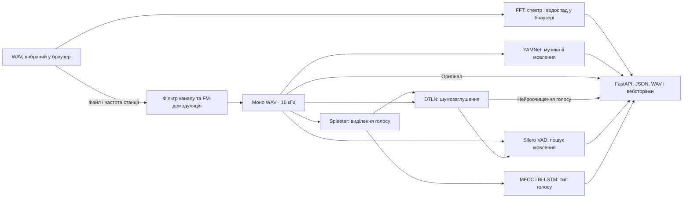

# Практична робота № 4 — вебсервіс для аналізу FM-записів

**Богдан Давиденко · РЕ-31**  
Середовище: Raspberry Pi OS (ARM64) · Python 3 · FastAPI · NumPy/SciPy · LiteRT та ONNX Runtime · JavaScript/Canvas

## 1. Мета роботи

Побудувати локальний вебсервіс, який приймає запис SDR, показує спектр і водоспад та розрізняє музику й мовлення. Для мовлення сервіс оцінює тип голосу, а в плеєрі дає порівняти ефір із нейроочищеною доріжкою. Під’єднаний SDR потрібен лише для створення I/Q-запису.

## 2. Архітектура та алгоритми



### Як запис перетворюється на звіт

1. **Із сигналу SDR отримуємо звук.** I/Q WAV зберігає два компоненти радіосигналу, а не лівий і правий аудіоканали. Програма вибирає смугу потрібної станції й за зміною фази відновлює звук FM. Для моделей готується моно WAV із частотою 16 кГц. Якщо вхід уже містить звичайне аудіо, FM-демодуляція не потрібна.
2. **Будуємо водоспад у браузері.** FFT з вікном Ганна показує, які частоти були сильнішими в кожному короткому відрізку I/Q. Браузер малює ці спектри один під одним. Горизонталь показує частоту, вертикаль — час.
3. **Виділяємо голос і розмічаємо ефір.** YAMNet оцінює, де чути музику, мовлення чи спів. Spleeter відділяє голос від музики, а DTLN чистить залишковий шум. VAD порівнює, де чути мовлення, в оригіналі, очищеній суміші та очищеному голосі. Так можна уточнити фрагмент, у якому ведучого було погано чути за музикою.
4. **Оцінюємо тип голосу й показуємо результат.** На ділянках із мовленням працює окремий класифікатор голосу. FastAPI віддає готовий звіт, водоспад і два варіанти звуку. **«Оригінал»** — декодований ефір, **«Нейроочищення»** — очищений виділений голос без підмішування оригіналу.

### Що означають терміни на схемі

- **Spleeter** — модель розділення звуку. Наприклад, коли ведучий говорить поверх музики, вона намагається винести голос в окрему доріжку. На цій доріжці може лишитися шум або частина музики.
- **DTLN** — нейромережа шумозаглушення мовлення. У нашому плеєрі вона працює **після Spleeter**: Spleeter відділяє голос від акомпанементу, DTLN приглушує шум, який залишився на виділеній доріжці.
- **Silero VAD** — детектор мовлення (*Voice Activity Detection*). Він відповідає на запитання «у який момент хтось говорить?». Він не записує слова в текст і не визначає тип голосу.

Під час підготовки запису з командного рядка `fm_station.py` також шукає **стереопілот** — службовий тон 19 кГц, який додає станція під час стереомовлення. Тон допомагає підтвердити стерео-FM. Його може не бути в моноефірі або слабкому записі.

### Як розрізняємо чоловічий і жіночий голос

VAD підказує, **де є мовлення**. Далі окрема модель **Bi-LSTM** оцінює, **як звучить голос**. Програма ділить фрагмент на короткі кадри й обчислює для них MFCC — числа, які описують розподіл енергії за частотами. Модель дивиться на послідовність цих ознак: вони передають тембр голосу та його зміни під час мовлення. Медіанну висоту голосу (**F0**) показуємо в таблиці для довідки: вона не визначає мітку сама по собі.

Коли мовлення йде поверх музики або короткий рядок залишився невизначеним, класифікатор отримує виділений голос. Він може взяти сусідні слова з тієї ж репліки й порівнює два вікна. Якщо оцінки недостатньо впевнені або не збігаються, у звіті лишається **«Не визначено»**.

Браузер передає вибраний WAV на Raspberry Pi під час першого запуску аналізу. Під час зміни частоти сервер бере той самий WAV і обробляє всю тривалість вибраної станції. Для кожної пари «файл + частота» зберігаються свої результати. Якщо повторно вибрати вже проаналізовану станцію в поточному сеансі сервера, сторінка відкриє готовий звіт. WebSocket `/ws/spectrum` доступний для потоку готових FFT-кадрів.

## 3. Структура проєкту

```text
prepare_recording.py   # Підготовка запису однією командою
fm_analyze.py          # FM-демодуляція та первинна розмітка
fm_channel.py          # Фільтрація та FM-демодуляція вибраного каналу
fm_jobs.py             # Приймання WAV, черга й результати аналізу
fm_quality.py          # FFT і спектральне шумозаглушення для повторного аналізу
fm_station.py          # Перевірка стереопілота
fm_vocals.py           # Відокремлення голосу за допомогою Spleeter
fm_neural_audio.py     # Нейромережеве шумозаглушення DTLN
fm_voice_focus.py      # VAD і аналіз типу виділеного голосу
sdr_web_app.py         # HTTP API і WebSocket
index.html, radio.js   # Спектр і водоспад
fm_report.js           # Плеєр, шкала та таблиця фрагментів
sdr_web.service       # Шаблон автозапуску через systemd
data/, models/        # Результати й ваги, створюються локально
```

## 4. Запуск на Raspberry Pi

Потрібні 64-бітна Raspberry Pi OS і Python 3.10–3.13. Встановлення залежностей і завантаження моделей виконуються один раз; подальша обробка не потребує інтернету.

```bash
sudo apt update
sudo apt install -y python3 python3-venv
python3 -m venv .venv
source .venv/bin/activate
python -m pip install -r requirements-fm.txt
python prepare_recording.py --download-models
```

З кореня проєкту запусти сервер:

```bash
python sdr_web_app.py
```

Відкрий сторінку сервера й вибери WAV. Якщо назва I/Q WAV містить частоту, наприклад `baseband_96000000Hz_capture.wav`, станція спочатку налаштовується на центр запису, а аналіз запускається автоматично. Для I/Q без частоти в назві вкажи **«Центр запису I/Q»**. Станція спочатку отримає те саме значення. Для звичайного PCM WAV аналіз запускається після вибору файлу. Підтримуються записи тривалістю від 0,5 с до 10 хвилин. Завантаження і звіти вебаналізу лежать у `data/browser_fm`.

| Адреса на Pi | Результат |
| --- | --- |
| `http://127.0.0.1:8000/` | Вибір WAV, водоспад, аналіз і дві звукові доріжки |
| `http://127.0.0.1:8000/docs` | Документація HTTP API |

**Зміна станції.** Аналіз запускається автоматично, коли введена частота потрапляє в смугу запису. Після завершення натисни **«Відкрити результат аналізу»**. У плеєрі доступні «Оригінал» і «Нейроочищення». Натисни на час у таблиці або на кольорову шкалу, щоб прослухати фрагмент.

Щоб слухати запис і стежити за спектром, вибери момент на водоспаді й натисни **«Послухати з цього моменту»**. Біла лінія й спектр оновлюються за часом плеєра. **«Пауза»** під водоспадом зупиняє звук і лінію.

